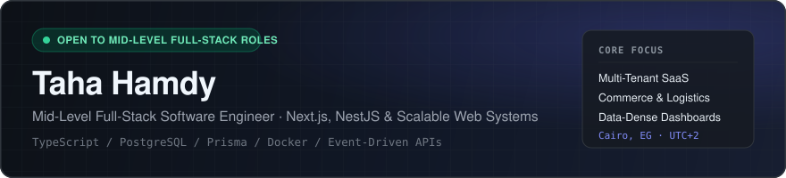

<picture>
  <source media="(prefers-color-scheme: dark)" srcset="./assets/hero-dark.svg" />
  <source media="(prefers-color-scheme: light)" srcset="./assets/hero-light.svg" />
  
</picture>

  

  
  &nbsp;
  
  &nbsp;
  
  &nbsp;
  

---

## Overview

<table>
  <tr>
    <td width="60%" valign="top">
      <h3>Engineering Focus</h3>
      

        Mid-Level Full-Stack Software Engineer turning product requirements into reliable, maintainable web applications. I work across responsive frontend interfaces and structured backend services—focusing on clean TypeScript contracts, predictable performance, and clear domain boundaries.
      

      <ul>
        <li><strong>Backend &amp; APIs:</strong> Modular services with <strong>NestJS</strong>, <strong>Node.js</strong>, and <strong>TypeScript</strong>.</li>
        <li><strong>Frontend Systems:</strong> SEO-friendly apps and data-dense dashboards with <strong>Next.js</strong>, <strong>React</strong>, and <strong>Tailwind CSS / Shadcn UI</strong>.</li>
        <li><strong>Data &amp; Persistence:</strong> Relational modeling, migrations, and transactions using <strong>PostgreSQL</strong>, <strong>MySQL</strong>, <strong>MongoDB</strong>, <strong>Prisma</strong>, and <strong>TypeORM</strong>.</li>
        <li><strong>Integrations:</strong> Payment gateways, idempotent webhooks, background queues, and CI/CD workflows.</li>
      </ul>
    </td>
    <td width="40%" valign="top">
      <h3>Profile Snapshot</h3>
      
<strong>Role:</strong> Mid-Level Full-Stack Engineer

      
<strong>Location:</strong> Cairo, Egypt (UTC+2)

      
<strong>Primary Stack:</strong> TypeScript, Next.js, NestJS, PostgreSQL

      
<strong>Building:</strong> Multi-tenant SaaS platforms, commerce backends, and VS Code developer tooling

      
<strong>Availability:</strong> Open to full-time roles and freelance architecture builds

    </td>
  </tr>
</table>

---

## Featured Projects

<table>
  <tr>
    <td width="50%" valign="top">
      <h4>NestJS Forge — VS Code Extension</h4>
      
Interactive VS Code scaffolding tool for generating NestJS modules, controllers, services, and DTOs with clean architectural conventions.

      
<code>TypeScript</code> <code>VS Code API</code> <code>NestJS</code>

      
<a href="https://github.com/TahaHamdy-MernDev/nestjs-forge-vs-extension">View Repository</a>

    </td>
    <td width="50%" valign="top">
      <h4>Admin Panel — Operations Dashboard</h4>
      
Responsive back-office portal featuring structured data tables, role-based views, and modern component primitives for daily operations.

      
<code>Next.js</code> <code>TypeScript</code> <code>Tailwind CSS</code>

      

        <a href="https://github.com/TahaHamdy-MernDev/admin-panel">View Repository</a>
        &nbsp;·&nbsp;
        <a href="https://admin-panel-sage-phi.vercel.app">Live Demo</a>
      

    </td>
  </tr>
  <tr>
    <td width="50%" valign="top">
      <h4>Buy From Egypt — Commerce Platform</h4>
      
Full-stack e-commerce storefront and order workflow designed for catalog browsing, structured checkout flows, and scalable product management.

      
<code>TypeScript</code> <code>Next.js</code> <code>Node.js</code>

      
<a href="https://github.com/TahaHamdy-MernDev/buy_from_egypt">View Repository</a>

    </td>
    <td width="50%" valign="top">
      <h4>Qwafel — Web Platform</h4>
      
Modern production web application built with TypeScript and deployed on Vercel with optimized rendering and responsive layouts.

      
<code>TypeScript</code> <code>React</code> <code>Vercel</code>

      

        <a href="https://github.com/TahaHamdy-MernDev/qwafel">View Repository</a>
        &nbsp;·&nbsp;
        <a href="https://qwafel-ecl6.vercel.app">Live Demo</a>
      

    </td>
  </tr>
</table>

---

## Core Tech Stack

<picture>
  <source media="(prefers-color-scheme: dark)" srcset="https://skillicons.dev/icons?i=ts,js,nextjs,react,tailwind,materialui,nestjs,nodejs,express,graphql&perline=10&theme=dark" />
  <source media="(prefers-color-scheme: light)" srcset="https://skillicons.dev/icons?i=ts,js,nextjs,react,tailwind,materialui,nestjs,nodejs,express,graphql&perline=10&theme=light" />
  
</picture>

  

<picture>
  <source media="(prefers-color-scheme: dark)" srcset="https://skillicons.dev/icons?i=postgres,mysql,mongodb,prisma,sequelize,redis,docker,nginx,githubactions,vercel&perline=10&theme=dark" />
  <source media="(prefers-color-scheme: light)" srcset="https://skillicons.dev/icons?i=postgres,mysql,mongodb,prisma,sequelize,redis,docker,nginx,githubactions,vercel&perline=10&theme=light" />
  
</picture>

---

## Engineering Principles

<table>
  <tr>
    <td width="50%" valign="top">
      <h4>Strict Type Safety &amp; Contracts</h4>
      
End-to-end TypeScript sharing paired with runtime schema validation (Zod, class-validator) to keep untrusted inputs out of core business logic.

    </td>
    <td width="50%" valign="top">
      <h4>Performance &amp; Rendering</h4>
      
Applying Next.js Server Components, streaming SSR, and caching strategies to reduce client JavaScript payloads and improve Core Web Vitals.

    </td>
  </tr>
  <tr>
    <td width="50%" valign="top">
      <h4>Resilient Workflows</h4>
      
Idempotent webhook processing, atomic database transactions on critical state transitions, and predictable error handling across services.

    </td>
    <td width="50%" valign="top">
      <h4>Modular Architecture</h4>
      
Clear separation between presentation, application services, and persistence layers so features remain testable, readable, and easy to extend.

    </td>
  </tr>
</table>

---

## Activity & Telemetry

<picture>
  <source media="(prefers-color-scheme: dark)" srcset="https://raw.githubusercontent.com/TahaHamdy-MernDev/TahaHamdy-MernDev/output/snake-dark.svg" />
  <source media="(prefers-color-scheme: light)" srcset="https://raw.githubusercontent.com/TahaHamdy-MernDev/TahaHamdy-MernDev/output/snake-light.svg" />
  
</picture>

  

<table>
  <tr>
    <td align="center" width="50%">
      <picture>
        <source media="(prefers-color-scheme: dark)" srcset="https://streak-stats.demolab.com/?user=TahaHamdy-MernDev&theme=github-dark-blue&hide_border=true" />
        <source media="(prefers-color-scheme: light)" srcset="https://streak-stats.demolab.com/?user=TahaHamdy-MernDev&theme=default&hide_border=true" />
        
      </picture>
    </td>
    <td align="center" width="50%">
      <picture>
        <source media="(prefers-color-scheme: dark)" srcset="https://github-readme-stats.shion.dev/api/top-langs/?username=TahaHamdy-MernDev&theme=github_dark&hide_border=true&include_all_commits=true&count_private=true&layout=compact" />
        <source media="(prefers-color-scheme: light)" srcset="https://github-readme-stats.shion.dev/api/top-langs/?username=TahaHamdy-MernDev&theme=default&hide_border=true&include_all_commits=true&count_private=true&layout=compact" />
        
      </picture>
    </td>
  </tr>
</table>

---

### Let's Connect

Open to discussions around mid-level full-stack roles, product engineering, and backend architecture.

**[Portfolio](https://taha-hamdy.vercel.app)** &nbsp;·&nbsp; **[LinkedIn](https://linkedin.com/in/tahahamdy)** &nbsp;·&nbsp; **[Email](mailto:contact@tahahamdy.dev)** &nbsp;·&nbsp; **[Repositories](https://github.com/TahaHamdy-MernDev?tab=repositories)**

