<picture>
  <source media="(prefers-color-scheme: dark)" srcset="./assets/profile-hero-v3-dark.svg" />
  <source media="(prefers-color-scheme: light)" srcset="./assets/profile-hero-v3-light.svg" />
  
</picture>

  

  <a href="https://taha-hamdy.vercel.app" target="_blank"><picture><source media="(prefers-color-scheme: dark)" srcset="./assets/btn-portfolio-dark.svg" /><source media="(prefers-color-scheme: light)" srcset="./assets/btn-portfolio-light.svg" /></picture></a>&nbsp;&nbsp;<a href="https://linkedin.com/in/tahahamdy" target="_blank"><picture><source media="(prefers-color-scheme: dark)" srcset="./assets/btn-linkedin-dark.svg" /><source media="(prefers-color-scheme: light)" srcset="./assets/btn-linkedin-light.svg" /></picture></a>&nbsp;&nbsp;<a href="mailto:contact@tahahamdy.dev"><picture><source media="(prefers-color-scheme: dark)" srcset="./assets/btn-email-dark.svg" /><source media="(prefers-color-scheme: light)" srcset="./assets/btn-email-light.svg" /></picture></a>&nbsp;&nbsp;<a href="https://github.com/TahaHamdy-MernDev?tab=repositories" target="_blank"><picture><source media="(prefers-color-scheme: dark)" srcset="./assets/btn-repos-dark.svg" /><source media="(prefers-color-scheme: light)" srcset="./assets/btn-repos-light.svg" /></picture></a>

 

### Core Tech Stack

 

<picture>
  <source media="(prefers-color-scheme: dark)" srcset="./assets/profile-stack-v2-dark.svg" />
  <source media="(prefers-color-scheme: light)" srcset="./assets/profile-stack-v2-light.svg" />
  
</picture>

  

### Engineering Principles

 

<picture>
  <source media="(prefers-color-scheme: dark)" srcset="./assets/profile-principles-v2-dark.svg" />
  <source media="(prefers-color-scheme: light)" srcset="./assets/profile-principles-v2-light.svg" />
  
</picture>

  

### Activity

 

<picture>
  <source media="(prefers-color-scheme: dark)" srcset="https://github-readme-activity-graph.vercel.app/graph?username=TahaHamdy-MernDev&bg_color=161b22&color=8b949e&line=c9d1d9&point=e6edf3&area=true&area_color=30363d&hide_border=false&border_color=30363d&radius=12&custom_title=Contribution%20Velocity" />
  <source media="(prefers-color-scheme: light)" srcset="https://github-readme-activity-graph.vercel.app/graph?username=TahaHamdy-MernDev&bg_color=f6f8fa&color=57606a&line=24292f&point=1f2328&area=true&area_color=d0d7de&hide_border=false&border_color=d0d7de&radius=12&custom_title=Contribution%20Velocity" />
  
</picture>

  

  <picture>
    <source media="(prefers-color-scheme: dark)" srcset="https://streak-stats.demolab.com/?user=TahaHamdy-MernDev&background=161b22&border=30363d&ring=8b949e&fire=c9d1d9&currStreakLabel=e6edf3&sideLabels=8b949e&currStreakNum=e6edf3&sideNums=e6edf3&dates=8b949e&border_radius=12" />
    <source media="(prefers-color-scheme: light)" srcset="https://streak-stats.demolab.com/?user=TahaHamdy-MernDev&background=f6f8fa&border=d0d7de&ring=57606a&fire=24292f&currStreakLabel=1f2328&sideLabels=57606a&currStreakNum=1f2328&sideNums=1f2328&dates=57606a&border_radius=12" />
    
  </picture>&nbsp;&nbsp;<picture>
    <source media="(prefers-color-scheme: dark)" srcset="https://github-readme-stats.shion.dev/api/top-langs/?username=TahaHamdy-MernDev&bg_color=161b22&border_color=30363d&title_color=e6edf3&text_color=8b949e&border_radius=12&include_all_commits=true&count_private=true&layout=compact&langs_count=6&card_width=419" />
    <source media="(prefers-color-scheme: light)" srcset="https://github-readme-stats.shion.dev/api/top-langs/?username=TahaHamdy-MernDev&bg_color=f6f8fa&border_color=d0d7de&title_color=1f2328&text_color=57606a&border_radius=12&include_all_commits=true&count_private=true&layout=compact&langs_count=6&card_width=419" />
    
  </picture>

