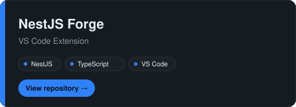
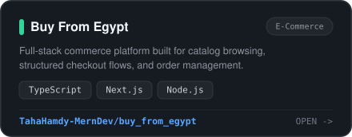
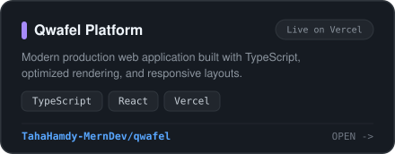
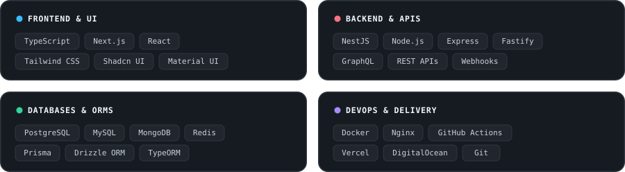

<picture>
  <source media="(prefers-color-scheme: dark)" srcset="./assets/bento-hero-dark.svg" />
  <source media="(prefers-color-scheme: light)" srcset="./assets/bento-hero-light.svg" />
  
</picture>

  

  
  &nbsp;
  
  &nbsp;
  
  &nbsp;
  

 

### Featured Projects

  <a href="https://github.com/TahaHamdy-MernDev/nestjs-forge-vs-extension" target="_blank">
    <picture>
      <source media="(prefers-color-scheme: dark)" srcset="./assets/project-nestjs-forge-dark.svg" />
      <source media="(prefers-color-scheme: light)" srcset="./assets/project-nestjs-forge-light.svg" />
      
    </picture>
  </a>
  &nbsp;&nbsp;
  <a href="https://github.com/TahaHamdy-MernDev/admin-panel" target="_blank">
    <picture>
      <source media="(prefers-color-scheme: dark)" srcset="./assets/project-admin-panel-dark.svg" />
      <source media="(prefers-color-scheme: light)" srcset="./assets/project-admin-panel-light.svg" />
      
    </picture>
  </a>

  <a href="https://github.com/TahaHamdy-MernDev/buy_from_egypt" target="_blank">
    <picture>
      <source media="(prefers-color-scheme: dark)" srcset="./assets/project-buy-from-egypt-dark.svg" />
      <source media="(prefers-color-scheme: light)" srcset="./assets/project-buy-from-egypt-light.svg" />
      
    </picture>
  </a>
  &nbsp;&nbsp;
  <a href="https://github.com/TahaHamdy-MernDev/qwafel" target="_blank">
    <picture>
      <source media="(prefers-color-scheme: dark)" srcset="./assets/project-qwafel-dark.svg" />
      <source media="(prefers-color-scheme: light)" srcset="./assets/project-qwafel-light.svg" />
      
    </picture>
  </a>

 

### Core Tech Stack

<picture>
  <source media="(prefers-color-scheme: dark)" srcset="./assets/bento-stack-dark.svg" />
  <source media="(prefers-color-scheme: light)" srcset="./assets/bento-stack-light.svg" />
  
</picture>

 

### Engineering Principles

<picture>
  <source media="(prefers-color-scheme: dark)" srcset="./assets/bento-principles-dark.svg" />
  <source media="(prefers-color-scheme: light)" srcset="./assets/bento-principles-light.svg" />
  
</picture>

 

### Activity & Telemetry

<picture>
  <source media="(prefers-color-scheme: dark)" srcset="https://raw.githubusercontent.com/TahaHamdy-MernDev/TahaHamdy-MernDev/output/snake-dark.svg" />
  <source media="(prefers-color-scheme: light)" srcset="https://raw.githubusercontent.com/TahaHamdy-MernDev/TahaHamdy-MernDev/output/snake-light.svg" />
  
</picture>

  

  <picture>
    <source media="(prefers-color-scheme: dark)" srcset="https://streak-stats.demolab.com/?user=TahaHamdy-MernDev&theme=github-dark-blue&hide_border=false&border=30363d&border_radius=12&background=161b22" />
    <source media="(prefers-color-scheme: light)" srcset="https://streak-stats.demolab.com/?user=TahaHamdy-MernDev&theme=default&hide_border=false&border=d0d7de&border_radius=12&background=f6f8fa" />
    
  </picture>
  &nbsp;&nbsp;
  <picture>
    <source media="(prefers-color-scheme: dark)" srcset="https://github-readme-stats.shion.dev/api/top-langs/?username=TahaHamdy-MernDev&theme=github_dark&bg_color=161b22&border_color=30363d&border_radius=12&include_all_commits=true&count_private=true&layout=compact" />
    <source media="(prefers-color-scheme: light)" srcset="https://github-readme-stats.shion.dev/api/top-langs/?username=TahaHamdy-MernDev&theme=default&bg_color=f6f8fa&border_color=d0d7de&border_radius=12&include_all_commits=true&count_private=true&layout=compact" />
    
  </picture>

 

**[Portfolio](https://taha-hamdy.vercel.app)** &nbsp;·&nbsp; **[LinkedIn](https://linkedin.com/in/tahahamdy)** &nbsp;·&nbsp; **[Email](mailto:contact@tahahamdy.dev)** &nbsp;·&nbsp; **[Repositories](https://github.com/TahaHamdy-MernDev?tab=repositories)**

