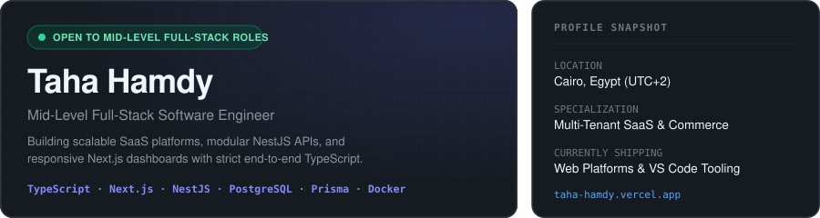
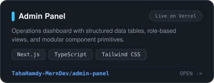
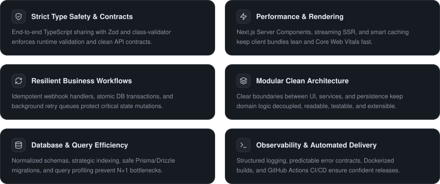

<picture>
  <source media="(prefers-color-scheme: dark)" srcset="./assets/bento-hero-dark.svg" />
  <source media="(prefers-color-scheme: light)" srcset="./assets/bento-hero-light.svg" />
  
</picture>

  

 

### Featured Projects

  <a href="https://github.com/TahaHamdy-MernDev/nestjs-forge-vs-extension" target="_blank">
    <picture>
      <source media="(prefers-color-scheme: dark)" srcset="./assets/project-nestjs-forge-dark.svg" />
      <source media="(prefers-color-scheme: light)" srcset="./assets/project-nestjs-forge-light.svg" />
      
    </picture>
  </a>
  &nbsp;&nbsp;
  <a href="https://github.com/TahaHamdy-MernDev/admin-panel" target="_blank">
    <picture>
      <source media="(prefers-color-scheme: dark)" srcset="./assets/project-admin-panel-dark.svg" />
      <source media="(prefers-color-scheme: light)" srcset="./assets/project-admin-panel-light.svg" />
      
    </picture>
  </a>

  <a href="https://github.com/TahaHamdy-MernDev/buy_from_egypt" target="_blank">
    <picture>
      <source media="(prefers-color-scheme: dark)" srcset="./assets/project-buy-from-egypt-dark.svg" />
      <source media="(prefers-color-scheme: light)" srcset="./assets/project-buy-from-egypt-light.svg" />
      
    </picture>
  </a>
  &nbsp;&nbsp;
  <a href="https://github.com/TahaHamdy-MernDev/qwafel" target="_blank">
    <picture>
      <source media="(prefers-color-scheme: dark)" srcset="./assets/project-qwafel-dark.svg" />
      <source media="(prefers-color-scheme: light)" srcset="./assets/project-qwafel-light.svg" />
      
    </picture>
  </a>

 

### Core Tech Stack

<picture>
  <source media="(prefers-color-scheme: dark)" srcset="./assets/bento-stack-dark.svg" />
  <source media="(prefers-color-scheme: light)" srcset="./assets/bento-stack-light.svg" />
  
</picture>

 

### Engineering Principles

<picture>
  <source media="(prefers-color-scheme: dark)" srcset="./assets/bento-principles-dark.svg" />
  <source media="(prefers-color-scheme: light)" srcset="./assets/bento-principles-light.svg" />
  
</picture>

 

### Activity

  <picture>
    <source media="(prefers-color-scheme: dark)" srcset="https://streak-stats.demolab.com/?user=TahaHamdy-MernDev&background=161b22&border=30363d&ring=2f81f7&fire=f0883e&currStreakLabel=2f81f7&sideLabels=8b949e&currStreakNum=e6edf3&sideNums=e6edf3&dates=8b949e&border_radius=16" />
    <source media="(prefers-color-scheme: light)" srcset="https://streak-stats.demolab.com/?user=TahaHamdy-MernDev&background=f6f8fa&border=d0d7de&ring=0969da&fire=bc4c00&currStreakLabel=0969da&sideLabels=656d76&currStreakNum=1f2328&sideNums=1f2328&dates=656d76&border_radius=16" />
    
  </picture>
  &nbsp;&nbsp;
  <picture>
    <source media="(prefers-color-scheme: dark)" srcset="https://github-readme-stats.shion.dev/api/top-langs/?username=TahaHamdy-MernDev&bg_color=161b22&border_color=30363d&title_color=e6edf3&text_color=8b949e&border_radius=16&include_all_commits=true&count_private=true&layout=compact&hide=html,tex,css,scss&langs_count=6" />
    <source media="(prefers-color-scheme: light)" srcset="https://github-readme-stats.shion.dev/api/top-langs/?username=TahaHamdy-MernDev&bg_color=f6f8fa&border_color=d0d7de&title_color=1f2328&text_color=656d76&border_radius=16&include_all_commits=true&count_private=true&layout=compact&hide=html,tex,css,scss&langs_count=6" />
    
  </picture>

